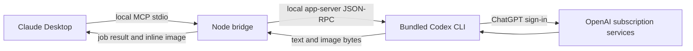

# ChatGPT Subscription MCP

Ask OpenAI questions and generate or edit images from **Claude Desktop**, using your **ChatGPT subscription** through the official Codex local interface. No OpenAI API key required.

Claude launches the bridge and its Codex backend automatically. **You do not need to keep ChatGPT, Codex Desktop, or a terminal window open.** Your computer and Claude must remain running while a job finishes.

This is an **unofficial local integration**, not an OpenAI or Anthropic product. It provides Codex-backed conversations and built-in image generation; it does not expose every ChatGPT feature or existing ChatGPT web conversations. Plan eligibility, workspace controls, and normal Codex usage limits still apply.

## Open source and community

**All project-owned code is public under the [MIT license](LICENSE):** the MCP server, Claude setup helper, tests, extension manifest, build scripts, and CI. There is no private edition or separate proprietary bridge component. You can fork it, change it, and submit improvements.

Start with the [contributor guide](CONTRIBUTING.md) and [roadmap](ROADMAP.md). Use [Discussions](https://github.com/corith37/chatgpt-subscription-mcp/discussions) for questions and design ideas, [Issues](https://github.com/corith37/chatgpt-subscription-mcp/issues/new/choose) for reproducible bugs and feature proposals, and [pull requests](https://github.com/corith37/chatgpt-subscription-mcp/pulls) to contribute changes. Setup, clearer errors, image previews, and cross-platform testing are especially welcome.

The [development guide](docs/DEVELOPMENT.md) maps the code and explains how to work without a subscription. The [release guide](docs/RELEASING.md) documents how the downloadable extensions are built from public source. Third-party components keep their own licenses; OpenAI's hosted models and services are external dependencies and are not included in this project's license. See [third-party notices](THIRD_PARTY_NOTICES.md).

## Install in Claude Desktop

### Desktop extension

1. Download the `.mcpb` matching your operating system **and CPU architecture** from [Releases](https://github.com/corith37/chatgpt-subscription-mcp/releases). Never install a Windows bundle on macOS or an x64 bundle on ARM.
2. In Claude Desktop, open **Settings → Desktop app → Extensions → Advanced settings → Install Extension**. Older Claude versions place Extensions directly in Settings.
3. Select the downloaded bundle. It includes the bridge and its pinned Codex runtime.
4. Ask Claude: **“Check chatgpt_status. If I need to sign in, call chatgpt_login and give me the login link.”** Open the link and sign in with your ChatGPT account. Existing Codex ChatGPT sign-in is reused.
5. Ask Claude to generate an image or ask OpenAI a question.

Claude must allow local desktop extensions, and its extension Node runtime must support Node 22 or later. There is no API key field. A custom extension is not the same as a remote connector: do not paste `localhost` into Claude's web connector dialog.

If no release bundle matches your platform, install from source below. Bundles are unsigned custom extensions, not reviewed directory listings.

### From source: Windows, macOS, Linux MCP clients

Install [Node.js 22 or later](https://nodejs.org/) and Git, then:

```sh
git clone https://github.com/corith37/chatgpt-subscription-mcp.git
cd chatgpt-subscription-mcp
npm ci
npm run doctor
```

If doctor reports that ChatGPT sign-in is required:

```sh
npm run login
```

Then install the Claude Desktop configuration:

```sh
npm run setup
```

Fully quit and reopen Claude Desktop. Setup preserves other MCP servers and preferences, backs up changed files, and uses absolute paths. On Windows it handles both the ordinary and Microsoft Store Claude config locations. Re-running setup is safe. Keep the cloned folder in place; rerun setup after moving it.

To select a config explicitly:

```sh
npm run setup -- --config /absolute/path/to/claude_desktop_config.json
```

On Windows PowerShell, use `npm.cmd` if your execution policy blocks `npm.ps1`. Claude Desktop availability and local extension support vary by OS; the server itself also works with other local MCP clients on Linux.

### Other MCP clients / Claude Code

Configure a local **stdio** server:

```json
{
  "mcpServers": {
    "chatgpt-subscription": {
      "command": "/absolute/path/to/node",
      "args": ["/absolute/path/to/chatgpt-subscription-mcp/src/cli.js"]
    }
  }
}
```

Windows JSON paths need escaped backslashes (or forward slashes). Run the Node entry directly, rather than `npm start`, to keep stdout free of npm messages. Claude Code can register this same command using its local MCP configuration. This project does not provide a public HTTP server or a claude.ai/mobile remote connector.

## Use it

Examples to ask Claude:

- “Ask OpenAI to critique this product idea, then compare its answer with yours.”
- “Generate a square watercolor illustration of a fox reading beside a window.”
- “Edit `C:/Users/me/Pictures/portrait.png`: replace the background with a pale blue studio backdrop.”
- “Continue that OpenAI conversation and ask for three alternatives.”
- “Cancel the image job that is still running.”

| Tool | Purpose |
| --- | --- |
| `chatgpt_status` | Check login, models, limits, and data location |
| `chatgpt_login` | Start the official browser login and return its URL |
| `chatgpt_ask` | Submit a question or conversation follow-up |
| `chatgpt_generate_image` | Generate or edit an image, optionally with local references |
| `chatgpt_job` | Poll a job and retrieve text, images, and a conversation ID |
| `chatgpt_cancel` | Request cancellation |
| `chatgpt_read_image` | Retrieve a generated image by its job and image IDs |

Submission tools return immediately with `job_id`. Claude should call `chatgpt_job` with `wait_seconds: 20` until `completed`, `failed`, `cancelled`, or `interrupted`. Image generation can take several minutes. Polling does not submit the prompt again. One generation runs at a time, with up to 16 queued requests per bridge process.

Pass `conversation_id` from a previous job to continue it. Conversations and completed job results survive a restart. A restart interrupts in-flight jobs; they are never silently retried. Cancellation cannot refund usage already consumed.

Image requests accept up to four local PNG/JPEG/WebP references, each up to 20 MiB. References must already exist on the same computer as the bridge: an attachment inside Claude is not necessarily a local file path. Describe desired size, transparency, composition, and edits in the prompt; these are model instructions, not guaranteed API parameters. Generated images up to 4 MiB are returned inline. Larger images are saved locally, with their full paths returned.

## How it works



The bridge uses the documented Codex app-server interface and native `imageGeneration` events. It does not scrape chatgpt.com, automate a hidden browser, extract cookies, copy access tokens, or fall back to billable API calls. The backend owns sign-in and token refresh. See the [design and feasibility notes](docs/DESIGN.md) for the options considered and remaining limitations.

## Settings and local data

| Environment variable | Default / behavior |
| --- | --- |
| `CHATGPT_MCP_DATA_DIR` | `~/.chatgpt-subscription-mcp`; use an absolute path |
| `CHATGPT_MCP_MODEL` | Account default from `model/list`; optional override |
| `CHATGPT_MCP_CODEX_PATH` | Bundled Codex; optional absolute native executable path |
| `CODEX_HOME` | Codex default `~/.codex`; controls its sign-in and state location |

Setup carries these explicit environment settings into the Claude configuration. Do not put API keys or passwords there. The source install uses the pinned `@openai/codex` dependency and does not upgrade or replace your globally installed CLI.

The data directory contains completed responses, image files, copied reference inputs, job metadata, and bridge-to-Codex conversation mappings. Codex separately retains its normal conversation/authentication state. Treat both directories as private. Data is not automatically deleted; close the bridge before removing its local data directory. Deleting it does not delete Codex's own saved conversations. Uninstalling the extension or removing its config entry stops future use; it does not log you out of other Codex clients.

## Troubleshooting

| Symptom | Next step |
| --- | --- |
| No tools in Claude | Fully quit/reopen Claude, check local extension policy and logs, run `npm run doctor` |
| Not signed in / API-key login detected | Use `chatgpt_login` or `npm run login` with ChatGPT sign-in |
| Model unavailable | Run doctor; remove a stale model override; update the bridge for a newer pinned runtime |
| No image returned | Read the job error; account eligibility, service refusals, and limits still apply |
| Job stays running | Poll the same ID; cancel if needed; the bridge times out after ten minutes |
| `interrupted` after restart | Review available results; explicitly submit a new request if desired |
| Reference image unavailable | Supply an absolute path to a local image the bridge can read |
| Image exceeds inline size | Open the returned local path; the original file is retained |
| Login link stops working | Keep Claude open, request a fresh login link, and complete it on this computer |

## Development and verification

```sh
npm ci
npm test
npm audit
npm run bundle
```

Tests use a fake backend and a real MCP stdio client; they require no account. CI tests Node 22/24 on Windows, macOS, and Linux. `npm run bundle` creates a platform-specific `.mcpb` and SHA-256 checksum under `dist/`. Bundling never includes your login, generated images, or local configuration.

Optional live checks **consume your plan limits**:

```sh
npm run smoke
npm run smoke -- --image --edit
```

On 2026-10-26, the full live flow was verified on Windows x64 with ChatGPT Plus and Codex 0.164.0: text, conversation continuation, image generation, image retrieval, and editing a reference image. Other platforms are covered by automated CI, but a passing unit test does not establish live account eligibility. Upstream app-server behavior is version-dependent and experimental; dependencies are pinned and the lockfile is committed.

See [SECURITY.md](SECURITY.md), [CONTRIBUTING.md](CONTRIBUTING.md), and [third-party notices](THIRD_PARTY_NOTICES.md). The bridge is MIT licensed; bundled components retain their own licenses.
